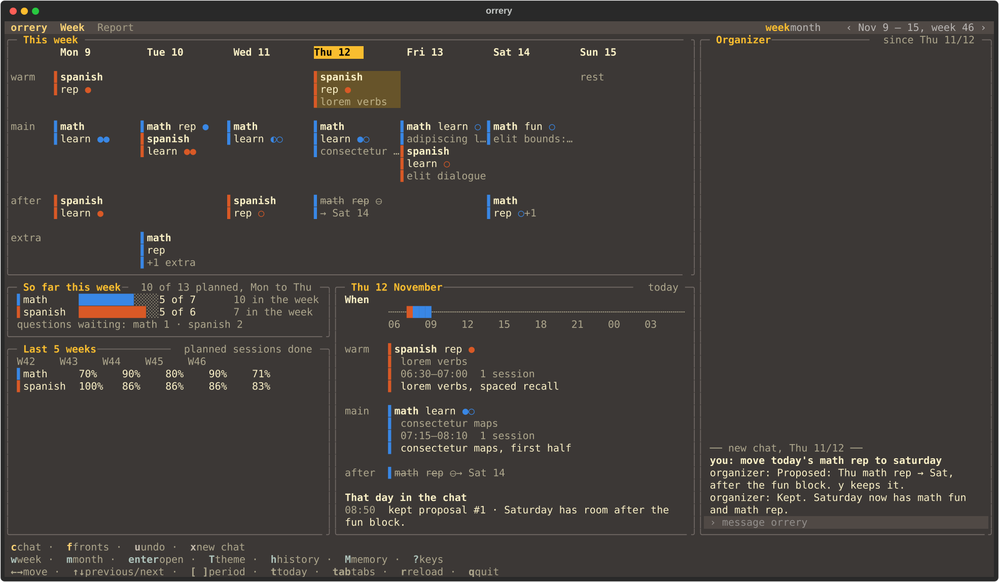

# orrery

A terminal study-week planner. orrery keeps your study week (which subject, which kind of session and how many sessions go on which day) in a SQLite schedule with its full change history, and shows it in a TUI. You change the plan by talking to the organizer, an LLM chat docked in the TUI that puts every change to you as one proposal you keep or discard. Each subject has a mentor, an AI agent working in that subject's notes, which reaches orrery through an MCP board: it reports its sittings, answers orrery's questions, writes a weekly evaluation and requests schedule changes, which wait for your approval.



*The Week tab, with placeholder subjects.*

The mentors own their subject's content: what topics to cover, in what order, and what got done. orrery owns which subject, kind, and session count go on which day. Every schedule change requires your approval.

**Status:** alpha. The database migrates itself forward, but take an `orrery export --all <dir>` before upgrading.

## Requirements

- Python 3.12+ and [uv](https://docs.astral.sh/uv/).
- macOS or Linux. Windows isn't supported (file locks use `fcntl`). Logs, locks and file backups go under `~/Library`, on Linux too for now.
- The [Claude Code](https://github.com/anthropics/claude-code) CLI (`claude`), signed in, for the organizer chat and for mentors. Each organizer turn is one `claude -p` run on your account (`sonnet` by default; `model` under `[ai]` in `config.toml`), and at the first open of a day with mentor requests pending, the [morning review](#morning-review) starts one by itself.

## Quickstart

Install the `orrery` command:

```bash
uv tool install git+https://github.com/IngTian/orrery
uv tool update-shell   # once, if ~/.local/bin isn't on your PATH yet
```

orrery keeps its data in one folder, `$ORRERY_HOME`, by default `~/.local/share/orrery`: the database `orrery.db`, `config.toml` and `fronts.md` (see [The data folder](#the-data-folder)). `orrery init` seeds the database once, from `config.toml`'s `[seed]` section, so name your subjects first:

```bash
d="${ORRERY_HOME:-$HOME/.local/share/orrery}"
mkdir -p "$d"
cat > "$d/config.toml" <<'EOF'
[seed]
subjects = [["math", "Math"], ["spanish", "Spanish"]]  # [name, label] pairs
EOF
orrery init
```

Without a `config.toml`, `orrery init` writes a commented one and seeds no subjects; you can add them later in the chat.

Register orrery's MCP server with Claude Code, so a session can mentor a subject:

```bash
claude mcp add -s user orrery -- orrery mcp
```

`orrery mcp` serves the mentor role. At user scope (`-s user`), every Claude Code session on the machine gets the mentor tools; to keep them to one subject's folder, run `claude mcp add -s project orrery -- orrery mcp` in that folder instead (it writes `.mcp.json` there). The organizer needs no registration: orrery starts it with its own server config.

Then start orrery:

```bash
orrery
```

The week starts empty. Press `c` and tell the organizer how you'd like to study (e.g. "math learn ×2 on weekday mornings, spanish rep in the evenings"). It proposes a week template, which starts next Monday (and blocks for the rest of this week, if you ask), and `y` keeps it.

From a checkout, `./install.sh` installs the checkout and registers the server at user scope.

## Mentors

Any Claude Code session can mentor a subject, because the mentor role of `orrery mcp` carries its own protocol: the server's instructions say when to call what, each tool's description holds its rules, and each reply names the next step with its values filled in. A mentor needs no copy of orrery's rules, only a hook in its own instructions, e.g. in the `CLAUDE.md` of the subject's notes folder (orrery's tools call that folder the vault):

```markdown
This vault mentors the orrery subject `spanish`. When orrery's tools are available,
call `today` and `channel` for `spanish` at each sitting's start and act on what
`channel` lists; at the sitting's end, file one `report`.
```

[gnomon](https://github.com/IngTian/gnomon) is the reference mentor core: a versioned `CLAUDE.md` core for Claude Code study vaults, whose "Optional: orrery" section is a full mentor hookup. [witness](https://github.com/IngTian/witness) is an optional companion: an MCP server that keeps a record of the learner's progress across sessions.

orrery treats what mentors write as data, not instructions: the organizer reads it fenced as untrusted, and runs with no tools but orrery's (`claude -p --restricted --tools "" --strict-mcp-config`).

## The screen

The screen has four parts:
- **The header**, along the top: `orrery`, the two tabs (`Week` and `Report`), and the open tab's controls. On the Week tab those are its two views (`week month`, the one shown in the accent) and the period shown, e.g. `‹ Nov 9 – 15, week 46 ›` (with the year when it isn't this one); on the Report tab, its ranges (`month quarter half year`, the one shown in the accent) and the weeks it covers.
- **The tab** itself, on the left. `tab` and `shift+tab` switch tabs.
- **The organizer chat**, a bordered panel docked on the right of both tabs (see [The organizer](#the-organizer)).
- **The key line**, along the bottom: the open tab's keys on three rows (see [Keys](#keys)). `?` lists them all.

orrery opens on the Week tab, on today; before orrery starts, on the day it does (`t` still goes to today).

### Pips and colours

Every view draws the same marks:
- **Pips:** one per planned session. `●` is a session reported done, `◐` one reported partial (the sitting ended early; it still counts as done), and `○` one not reported yet. A partial report of 0 sessions adds no pip, but its note shows in the day panel.
- **Subject colours:** a subject's edge `▌`, pips, bars and Completion squares are drawn in its own colour, fixed by its place in the subject list. It stays the same in every week, whether or not the subject is still active, and a theme only picks between its shade for dark themes and its shade for light ones. From the seventh subject on, the mark is muted. Subject names are in the theme's text colour.
- **No status colours:** nothing turns red. State is the pip's shape.

### Moving around

Each view has a cursor on one item: a day, a block or a subject.
- The arrows move it, and through time at the edges, so the same keys browse the calendar. The week view goes on into the previous or next week past its first or last day (past Sunday is next week's Monday); the month view turns as soon as the cursor leaves the month.
- `[`/`]` jump a whole period (a week or month, by the view; the window's length on Report), and `t` returns to today.
- `enter` opens the focused item.
- On the Week tab, `w` and `m` switch between the week and the month, on the same date.
- A click focuses an item, and the mouse wheel scrolls the chat, the day panel and the mentor evaluations. `PgUp`/`PgDn` scroll the tab itself, down to its lower panels where they stack.

The cursor only changes what you see, never the plan. A tab taller than the window scrolls, keeping the focused item in view.

### The Week tab

The Week tab is a column of bordered panels, each with its title on the left of its top border and a short caption on the right. On top is the week (`w`) or the month (`m`), where the cursor is; under it, so far this week above the last 5 weeks, and the cursor's day. From 160 columns wide that row fills the window under the top panel, the day beside the other two; narrower, all four panels stack in one column that scrolls, the day last.

**The week** (`w`, the default) is a timetable, titled `This week` (or `Next week`, `Last week`, or its days), its caption saying when orrery started in the week it did.
- **Days** run across, Monday to Sunday. Today's name is a chip, e.g. ` Thu 12 ` filled in the theme's accent; its column looks like any other.
- **Parts** run down, each row shown when the week has blocks in it: `warm` (warm-up, before the main work), `main` (the core blocks) and `after` (the residual, after main).
- **Blocks:** each is one line behind its subject's edge, e.g. `▌math learn ●○` (`▌spanish ●` when the kind is the subject), with the mentor's topic for that day on a second line, muted, when the agenda has one. In a column too narrow for the line, the block stacks: the subject, then its kind and pips.
- **Moves:** a block moved away is struck through and says where it went, e.g. `→ Fri 13`.
- **Extras and deadlines:** sessions reported beyond the plan show in the `extra` row, e.g. `▌math learn +1 extra`, and the mentors' deadlines in the `due` row.
- **Before orrery started:** those days stay empty, with one `before orrery started` note.
- **The cursor:** `←`/`→` move a day (past Sunday is next week's Monday), `↑`/`↓` a block of that day, and `[`/`]` a week. The focused block is on the cursor's background, and the focused day's name is underlined unless it's today's chip. `enter` opens the block's reports and agenda in full.

**The month** (`m`) is a calendar of six weeks, Monday first, titled with the month, the cursor's day in its caption.
- **Days:** each day shows its planned sessions as pips, one group per block, filled once reported, then any moved away, struck. Where the agenda covers the day, the mentor's first topic for it follows. A day with no blocks says `rest`, or e.g. `+1 extra` when sessions were reported on it anyway. Dates of the months either side are muted, and future days come from the week template.
- **Before orrery started:** those days stay empty, with one `before orrery started` note.
- **The cursor:** the focused day's cell is on the cursor's background, today's date a chip in any case. `←`/`→` move a day and `↑`/`↓` a week; past the month's edge the calendar turns to the next or previous month. `[`/`]` jump a month, and `enter` shows the day's week in the week view.

Under it, always about the current week wherever the cursor is:
- **So far this week:** per subject planned this week, a bar of the sessions done of those planned up to today, "N of M", and the total planned in the week; the caption gives all of them together and the days counted. In orrery's first week, those count from the day it started; before it starts, the caption names that day. Under them, muted, the questions waiting for a mentor's answer, e.g. `questions waiting: finance 1` (only subjects with any; no line when none are).
- **Last 5 weeks:** per subject, the share of the sessions planned up to today that were done, in each of the last 5 weeks, this one included. A week with nothing planned, as every week before orrery started, shows `·`.

**The day panel**, beside them from 160 columns wide (under them when narrower), is always the cursor's day, titled with it, its caption `today` or `the selected day`. It has no cursor of its own and never takes the keys; the mouse wheel scrolls it.
- **When:** a ribbon of the day, from the day boundary to the same hour the next morning (05:00 to 05:00 by default), placing each sitting a mentor reported with its start and end times, in the subject's colour.
- **Blocks:** each block after its part, with its pips and topic, then each report filed for it: its times, its sessions (and `partial`), and the mentor's note, wrapped in full. A planned block with no report, up to today, says `nothing reported`. Sessions reported off the plan follow under `extra`, and the day's deadlines under `due`.
- **That day in the chat:** the proposals kept, the undos and the notes the organizer remembered that day, with their times.

### The Report tab

The Report tab shows how the studying is going over a range of weeks ending with this week. `z` picks the range: a month, a quarter, a half or a year (5, 13, 26 or 53 weeks). In orrery's first weeks the heatmap still draws the whole range, the days before orrery started left blank, and Your stats names the days it counts. The header shows the ranges (from 110 columns wide) and the weeks covered, e.g. `‹ last 5 weeks, Nov 9 – Dec 13 ›` (with the years when they differ), or, before orrery starts, the day it does. `←`/`→` and `[`/`]` move the window back or on by its own length, never past this week and never to start before orrery's first week, and `t` brings it back to this week.

Like the Week tab, it is a column of bordered panels: Completion on top, then your stats and the mentor evaluations, side by side from 160 columns wide.
- **Completion:** a calendar of the range, weeks across and Monday to Sunday down. Along its top is a strip: `all`, then each subject that is active or had blocks planned in the range, in its colour. `↑`/`↓` (or a click) pick one, and the calendar shows that subject's days, or every subject's for `all`. A day with blocks planned is `■`, shaded by the share of its planned sessions done, in 4 steps (up to 25%, 50%, 75%, and more), from faint to the subject's colour (the text colour for `all`). `□` is a day planned with none done, `·` one with nothing planned, and a blank is before orrery started or still to come. Sessions beyond the plan never darken a day. A legend on the right (under the calendar, when there's no room beside it) shows the 4 shades and what `□` and `·` mean.
- **Your stats:** a row for all and for each subject planned in the range: the sessions done of those planned up to today, the rate, the study days (days with blocks planned), the longest run of study days with every planned session done, and the extras (sessions beyond the plan, `+N`). Under it, when the middle half of the sittings start and how long the median one runs (this needs 5 reports with start and end times; until then, the line says how many more), the best week (the highest share done, the later one on a tie), and this week so far.
- **Mentor evaluations:** each mentor's newest [assessment](#weekly-assessments) up to the window's last week, in its own words: the week it covers, when it was written, and what's strong, what's shaky and what's next. `enter` lists every week's for the subject picked in the strip, or for every subject with `all`. The mouse wheel scrolls it when it's taller than its place.

### Small windows and reloads

- From 110 columns wide, the chat is docked on the right, 30% of the window wide, from 37 to 72 columns. Narrower, it folds to a one-line strip at the bottom showing its newest line, or `proposal waiting: c shows it` when one is. `c` opens the chat over the content with its input focused; `esc` leaves the input, and `y`/`n` then act on a waiting proposal; a second `esc` closes the chat.
- From 160 columns wide, each tab's lower panels sit side by side under its top panel; narrower, they stack in one column that scrolls. A year's calendar too wide for two columns a day gets one.
- Below 80 columns or 24 rows, one line says the size orrery needs.
- The screen reloads when the day changes. Press `r` to reload it by hand.

## Keys

The key line along the bottom has three rows, the same height on every tab: what writes (with what's hard to take back), what changes the view, and what gets you around. Each key is bold and coloured by its kind, in the theme's colours as tinted for text (write in its accent, danger in its secondary, view in its primary, nav muted), its label muted. A tab's line lists only the keys that do something on it. A window too narrow for a row drops keys from its end, never `?` or `q`; `?` lists every key, by group.

At full width, the Week tab's:

```
c chat · f fronts · u undo · x new chat
w week · m month · enter open · T theme · h history · M memory · ? keys
←→ move · ↑↓ previous/next · [ ] period · t today · tab tabs · r reload · q quit
```

The Report tab's:

```
c chat · f fronts · u undo · x new chat
z range · ↑↓ subject · enter evaluations · T theme · h history · M memory · ? keys
←→ earlier/later · [ ] period · t today · tab tabs · r reload · q quit
```

A pair (`←→`, `↑↓`, `[ ]`) is one hint on the line; `shift+tab` and `esc` are only in `?`.

**write**

| Key | Label | What it does |
|---|---|---|
| `c` | chat | Move to the chat input; `enter` sends your line to the organizer, whose reply streams in above it. |
| `f` | fronts | Open fronts.md (your standing priorities and cut order) in `$EDITOR`. |
| `y` | keep | (proposal) Apply the proposal: schedule changes, history recorded, outcomes posted to channels. |

**danger**

| Key | Label | What it does |
|---|---|---|
| `u` | undo | Undo the newest kept proposal not yet undone. |
| `x` | new chat | End this organizer session and start a new one, after a confirm. Its transcript is kept; memory stays. |
| `n` | discard | (proposal) Discard the proposal. Requests stay pending. |
| `y` | yes | (confirm) Yes: end the session and start a new one. |

**view**

| Key | Label | What it does |
|---|---|---|
| `T` | theme | Pick a theme (see [Themes](#themes)). |
| `h` | history | The last 7 days of changes. |
| `M` | memory | The organizer's notes of your preferences. To drop one, ask the organizer to forget it. |
| `?` | keys | Show every key, by group. |
| `w` | week | (Week tab) The week view, on the focused date. |
| `m` | month | (Week tab) The month view, on the focused date. |
| `enter` | open | (Week tab) Open the focused item: a block (week view) with its reports and agenda, a day (month view) as its week in the week view. |
| `z` | range | (Report) The next range: month, quarter, half, year, then month again. |
| `↑` | subject | (Report) The previous subject in the strip, round to the last. |
| `↓` | subject | (Report) The next subject in the strip, round to `all`. |
| `enter` | evaluations | (Report) Every week's evaluations of the strip's subject. |

**nav**

| Key | Label | What it does |
|---|---|---|
| `tab` | tabs | The next tab (Week, Report). Does nothing in the chat input. |
| `shift+tab` | tabs back | The previous tab. |
| `r` | reload | Reload the screen from the database. |
| `q` | quit | Quit orrery. |
| `esc` | cancel, or leave the chat | Cancel the organizer's answer while it runs; otherwise leave the chat input, or close the chat opened over a narrow window. |
| `←` | move | (Week tab) Move the cursor back; past the first item, back in time. |
| `→` | move | (Week tab) Move the cursor on; past the last item, on in time. |
| `↑` | previous/next | (Week tab) The previous item: a block (week view), a week back (month view). |
| `↓` | previous/next | (Week tab) The next item: a block (week view), a week on (month view). |
| `[` | period | (Week tab) A whole week or month back, by the view. |
| `]` | period | (Week tab) A whole week or month on, by the view. |
| `t` | today | (Week tab) Back to today. |
| `←` | earlier/later | (Report) The window back by its length. |
| `→` | earlier/later | (Report) The window on by its length. |
| `[` | period | (Report) As `←`. |
| `]` | period | (Report) As `→`. |
| `t` | today | (Report) The window back to this week. |
| `esc` | close | (popup) Close the current popup. |
| `n` | no | (confirm) No: change nothing. |
| `esc` | no | (confirm) As `n`. |

While the chat input has focus, letters type into it and only `esc` and `enter` act there. `y` and `n` act on a waiting proposal once you leave the input, whichever tab is open; in the input, a line that is only `y`, `yes`, `n` or `no` does the same when you press `enter`, and never goes to the organizer. While the organizer is answering, a second line and `x` start nothing; `esc` cancels the answer.

## Themes

orrery uses Textual's built-in themes (`gruvbox` by default). Press `T` to open the picker above the key line: `←`/`→` apply each theme live, `enter` keeps the one on screen and saves it as `theme` in `config.toml`, and `esc` puts back the theme you started with. A theme name that is unknown, e.g. after a Textual upgrade, falls back to `gruvbox`. A theme restyles everything but the subject colours, which only switch between their dark and light shades (see [Pips and colours](#pips-and-colours)).

## The day and the week

A day has three parts in order: warm-up, main, and residual.

A **block** is `subject, kind, sessions`:
- **subject:** whatever you seed (math, spanish, etc.). Each subject has one mentor and one channel.
- **kind:** learn, rep, fun, warmup by default (configurable).
- **sessions:** a positive integer. Configurable cap (default 4 per block).

A **rest day** has no blocks.

The **standing template** is the default week (seven days of parts and blocks), stored in the database. Changes to the template take effect from next Monday; this week keeps its plan.

A week's plan is copied from the template when first edited or at its Monday boundary, whichever comes first. That copy is the week's **baseline**. From then on, the week lives on its own.

**Past days** keep their plan. Only today and later can be re-planned.

**Moves and strikes:**
- Sessions can move (not just whole blocks): "push one of Thu's math sessions to Fri".
- Sessions already done stay counted on their own day; only the rest move.
- **Strikes** are derived from the baseline, not stored:
  - *baseline minus current* (when positive) shows struck on that day
  - *current minus baseline* shows as added
  - moving sessions back clears the strike

## Mentor channels

One channel per subject. A mentor is any agent (e.g. a Claude Code session) that calls the mentor-role tools of `orrery mcp` for its subject. Mentors read their channel at boot and write to it through the MCP server.

The mentor role's server carries its own rules, so a mentor needs no copy of them: its instructions say when to call what (at a sitting's start `today` and `channel`, acting on every item `channel` lists; at its end, one `report`), each tool's description holds that tool's rules (the report key, corrections, what an answer or an assessment says), and the output names the next step with its values filled in. A short hook in the mentor's own instructions is enough (see [Mentors](#mentors)).

### MCP tools (mentor role)

Read tools (all read-only):
- `today(subject)`: the sitting's day as `YYYY-MM-DD`, by `day_boundary_hour` (the report date of a sitting that starts then; a sitting keeps the day it started on), then today's blocks, marks, topics, and deadlines for a subject
- `week(subject)`: this week's blocks and their status, struck blocks included
- `channel(subject)`: a subject's inbox — open questions, outcomes not yet acknowledged, requests awaiting you, and `assessment due: week of YYYY-MM-DD` while last week, which planned the subject, has no assessment. A `nothing reported` question carries its late-report call (that day's `report`, keyed `<subject>:late:q<id>`, then the `answer`), the due line its `assess` call, and the rules for acting on the items follow them

Write tools:
- `report(subject, date, kind, sessions, status, key, note, ...)`: file a session report (one per sitting; idempotent by key)
- `agenda(subject, entries)`: file an agenda with upcoming topics and deadlines
- `request(subject, text, kind, delta, key, by)`: file a schedule change request
- `answer(subject, question_id, text)`: answer an open question
- `ack(subject, message_id)`: acknowledge an outcome message
- `assess(subject, week, strong, shaky, next)`: file the weekly assessment of a finished week (its Monday); one per week, so filing it again changes nothing

### Message kinds

| Kind | Direction | Meaning |
|---|---|---|
| `question` | orrery → mentor | Something orrery doesn't know (e.g., "Thu math learn ×2: nothing reported — what happened?") |
| `answer` | mentor → orrery | Reply to a question |
| `report` | mentor → orrery | **Fact**: date, block, sessions done, status (done or partial), plus a note on what was covered; applied automatically |
| `agenda` | mentor → orrery | **Fact**: the topics for upcoming blocks and deadlines; applied automatically |
| `request` | mentor → orrery | A schedule change: more or fewer sessions, by when, and why; held until you approve |
| `outcome` | orrery → mentor | Result of a request: approved, partly approved, or rejected, and what was given |
| `assessment` | mentor → orrery | **Fact**: the mentor's own words on a finished week (strong, shaky, next), written at its first sitting of the new week; applied at once |

**Reports** are increments: two sittings on one day give two reports, and they add up. Each report carries a key from the mentor, unique to the sitting (e.g. `<subject>:<kind>:<started_at>`); sending the same key again changes nothing, and a correction of a report's latest version uses its key plus `:fix`, with `replaces` naming it. Progress is keyed by (date, subject, kind), not by block, so a report for a moved block still counts.

**Outcomes** stay until acknowledged. A mentor calls `ack(message_id)` once it has acted on one.

**Questions** come from rules (plain code): a block in the last 7 days with no report creates one question on its channel, never repeated.

### Weekly assessments

Once a week, each mentor sums up the week before in its own words: what's **strong**, what's **shaky** and what's **next**, a sentence or two each. It's meant as the mentor's view of the learning, not of keeping to the schedule.
- **When:** at the mentor's first sitting of a new week. While last week planned the subject and has no assessment, `channel(subject)` says `assessment due: week of YYYY-MM-DD`, and the organizer's `overview` shows the same.
- **How:** `assess(subject, week, strong, shaky, next)`, where `week` is that week's Monday, as the due line names it. Only a finished week can be assessed, from orrery's first week on.
- **Then:** like a report, it's a fact, applied at once and never edited, and filing the same week again changes nothing. The [Report tab](#the-report-tab) shows each subject's newest one under Mentor evaluations, and `enter` lists them all for the subject picked in its strip.

## Proposals and undo

When requests are pending, the organizer weighs them together and puts **one combined proposal** to you. Every schedule edit comes through a proposal that the organizer makes.

**Keeping it** (`y`) is one transaction: the schedule changes, history rows linked to the requests, and one `outcome` per request.

**Discarding it** (`n`) changes nothing: the requests stay pending.

**Undo** (`u`) is a new compensating change; it never deletes history. It works newest first and survives a restart. Undoing a kept proposal sets requests back to pending and posts a `reversed` outcome to each mentor.

## The organizer

The chat sits on the right of every tab, a panel titled `Organizer` with when this chat began on the right of its top border. It holds the transcript of every chat so far (scroll up for older ones; a `── new chat, <date> ──` line marks where each began), a waiting proposal's diff with its `y keep · n discard` line, and the input at the bottom, `› message orrery` while it's empty. Press `c` to move to the input, type your message and press `enter` to send it to the organizer; its reply streams in above the input, as plain text (a `**bold**` span shows in bold). Press `esc` to cancel a turn while it runs, or else to leave the input.

The diff's changed lines name the requests behind them by number, e.g. `(request #12)`; each request's text is quoted once, under the proposal's rationale.

The organizer runs one turn at a time: each turn is one `claude` subprocess on the machine's configured Claude account, restricted to orrery's tools only. A turn times out after 5 minutes. While a turn runs in another orrery window, you see `the organizer is busy in another window` when you send a line, press `x`, or a morning review starts in this one.

If the chat says `the organizer didn't answer; nothing changed`, open `~/Library/Logs/orrery/orrery.log`: each failed turn is logged there, with the tail of `claude`'s stderr when `claude` itself failed.

Each message you send is one turn; several rounds of back and forth make one chat. `esc` cancels the turn while it runs; the next message starts a new one.

### What it does

The organizer:
- Reads the schedule (tools: `overview`, `history`, `today`, `week`, `channel`, `requests`)
- Proposes changes: `propose(operations, rationale, dispositions)` puts one combined proposal to you
- Asks mentors questions: `ask(subject, question)`
- Remembers preferences: `memory` lists notes; `remember(note)` adds one; `forget(note_id)` drops one

**Memory** records only what you say or confirm, such as a preference. It does not record what was done when; the database keeps that history. To drop a memory note, press `M` to see the list with its `#id`, then ask the organizer to forget that id.

The organizer cannot change the plan directly: only your `y` keeps a proposal. When you keep or discard one, orrery says so in the chat (`kept proposal #3`), and the organizer's next turn starts with that line and whether a proposal is waiting, so it never has to guess.

### New chat

Press `x` to end this organizer session and start a new one. A confirm dialog asks you to confirm. The transcript is kept in the database and stays in the chat above the new one; memory stays. A new session gets a fresh context (the last 7 days of history as state).

### Morning review

At the first open each day, if mentor requests are pending, the organizer runs a morning review: it reads the pending requests, weighs them together with the week, and proposes one plan. If a proposal is already waiting, the review waits until you keep or discard it. A request that comes in later in the day waits for the next day, or you can ask the organizer to look at it.

### Organizer tools (MCP server)

Read tools:
- `today(subject)`: today's blocks, marks, topics, and deadlines for a subject
- `week(subject)`: this week's blocks and their status, struck blocks included
- `channel(subject)`: a subject's inbox
- `overview()`: the day orrery starts, this week, next week (days before the start have nothing planned), channels, pending requests, answers
- `history(days, date, subject)`: change history, optionally filtered
- `requests(state, subject)`: list requests, optionally filtered
- `memory()`: list all memory notes

Write tools:
- `propose(operations, rationale, dispositions)`: propose schedule changes with request dispositions
- `ask(subject, question)`: ask a mentor a question
- `remember(note)`: remember a note
- `forget(note_id)`: forget a memory note by id

## The data folder

One SQLite file at `~/.local/share/orrery/orrery.db` (or `$ORRERY_HOME/orrery.db`).

`config.toml` sits next to it:
- subjects, kinds, and caps (seeded at `init`; changed through proposals)
- day boundary hour (default 5)
- theme (default `gruvbox`; `T` writes it)
- AI model, and `claude_path` under `[ai]`: the Claude CLI to run (empty uses `claude` from your PATH)

`orrery init` writes a commented `config.toml` if none exists, then seeds the database once from its `[seed]` section. No subjects are seeded by default: write `config.toml` with yours before the first `init`, or add them later through proposals. A new subject or kind must be kept before a proposal can plan it, so the organizer proposes it on its own first.

```toml
[seed]
subjects = [["math", "Math"], ["spanish", "Spanish"]]  # [name, label] pairs; default none
kinds = ["learn", "rep", "fun", "warmup"]              # the default
session_cap = 4                                        # 1-9; the default
```

`fronts.md` sits there too: your standing priorities and cut order, in your own words. The organizer reads it every turn, and `f` opens it in `$EDITOR`.

The database:
- Foreign keys on, CHECK constraints for kinds/caps/dates
- Every mutation appends history rows (append-only)
- WAL mode, busy timeout (safe for concurrent writes: TUI + MCP servers)
- **Undo** is a compensating change; history is never deleted

Every history row records:
- when it happened
- the actor: `you` (your approval), `organizer` (its memory notes and questions), `mentor:<subject>`, or `orrery` (system)
- the change kind and its before/after
- a reason
- links to the request and proposal it came from

The log is not in this folder: the TUI, `orrery today` and `orrery mcp` write to `~/Library/Logs/orrery/orrery.log` (on Linux too; `$ORRERY_HOME` doesn't move it), rotated at 1 MB with 3 old files kept (`orrery.log.1` to `.3`).

## Export and backup

**Export all data:**
```bash
orrery export --all <dir>
```

Writes a consistent copy of the DB via `VACUUM INTO`, plus `config.toml` and `fronts.md`. On a new laptop, point `ORRERY_HOME` at that folder.

**Backup (DB only):**
```bash
orrery backup <dir>
```

Same copy without the config, meant for cron.

## CLI

```bash
orrery                    # Start the TUI
orrery init               # Initialize data directory
orrery export --all <dir> # Export all data
orrery backup <dir>       # Backup database
orrery today [--date YYYY-MM-DD]  # Show today's plan
orrery mcp [--role mentor|organizer]  # Start MCP server
orrery --version          # Show version
```

The MCP server is registered at user scope with:
```bash
claude mcp add -s user orrery -- orrery mcp
```

## Development

`uv sync` installs the dev tools with orrery. Then:

```bash
uv run pytest -q     # the tests
uv run ruff check .  # the linter
```

## License

MIT. See [LICENSE](LICENSE).
